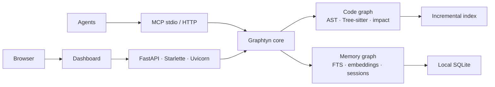

# 🌌 Graphtyn

[](https://github.com/CaleroAM/graphtyn/releases/latest)
[](LICENSE)
[](https://www.python.org/)
[](https://modelcontextprotocol.io/)

**Language:** English · [Español](README.es.md)

Graphtyn builds a local, auditable graph of your code, computes the impact of a change and hands
AI coding agents a compact, evidence-backed context through MCP. Agents answer "what breaks if I
change this?" or "how does this request flow?" from `file:line` evidence instead of reading the
whole repository. Optionally, it also keeps a shared memory of past sessions across agents,
separate from the code graph.

> Latest stable release: [`0.13.1`](https://github.com/CaleroAM/graphtyn/releases/tag/v0.13.1).
> Graphtyn is distributed through GitHub Releases; PyPI is not enabled yet. It is self-hosted:
> agents can share memory with per-token, per-project permissions, but it is not a multi-tenant
> SaaS.

**Docs:** [index](docs/index.md) · [architecture](docs/ARCHITECTURE.md) ·
[memory](docs/shared-memory.md) · [per-project MCP](docs/project-mcp-integrations.md) ·
[OpenClaw](docs/openclaw-native.md) · [testing](docs/testing.md) ·
[benchmarks](docs/BENCHMARKS.md) · [security](docs/SECURITY.md). Most detailed guides are in
Spanish.

## Why Graphtyn

Graphtyn's aim is to let agents answer code questions from `file:line` evidence while reading less.
Every claim below comes from a reproducible benchmark:
- public repositories at fixed commits;
- rubrics frozen before running;
- three LLM judges, scored by majority; against the maintainer's hand grades, that rule agreed
  with kappa 0.95 and gave no false credit.

Negative results are published too.

**Latest head-to-head (2026-11-15):** no graph vs Graphtyn vs Graphify 0.9.106. It used 8 new
impact and flow tasks on click, gin, koa and jsoup, none of which was ever used to tune Graphtyn,
with 3 repetitions ([report](benchmarks/graphify_head_to_head_2026-11-15/report.md)):

| Client | Arm | Facts found | Median tokens |
|---|---|---:|---:|
| Claude Code (Sonnet) | No graph | **155/162** | 102,232 |
| Claude Code (Sonnet) | Graphtyn | 146/157 | **93,121** |
| Claude Code (Sonnet) | Graphify | 150/162 | 103,380 |
| Codex | No graph | **137/162** | 99,213 |
| Codex | Graphtyn | 90/162 | **30,999** |
| Codex | Graphify | 136/162 | 176,603 |

- **Tokens:** Graphtyn uses the fewest with both clients: 30 % fewer than Graphify with Claude
  Code and 80 % fewer with Codex. Graphify spent more than not using a graph at all.
- **Quality:** on these repositories, Graphtyn did **not** beat reading the code directly.
  Two retrieval failures explain most of the gap:
  - test callers crowded production consumers out of an impact package;
  - a package declared itself complete while calls through an untyped receiver were still
    unresolved.
  Codex trusts the package and stops searching, so it is hit hardest. Both failures are open
  issues.
- **Earlier result:** in the previous head-to-head (2026-11-06; redis, fmt, rails and flask),
  Graphtyn found the most facts with Claude Code: 118/118, against 114 for Graphify
  ([report](benchmarks/graphify_head_to_head_2026-11-06/report.md)). On new repositories that
  advantage did not hold.

In short, today Graphtyn is the cheapest way to give an agent code context, and its answers are
close to, but not yet better than, those of an agent reading the code itself. All benchmarks are
listed in [docs/BENCHMARKS.md](docs/BENCHMARKS.md).

## What it does

- **Deterministic code graph:** files, symbols, calls, inheritance and framework relations. Every
  edge is labelled `EXTRACTED`, `INFERRED` or `AMBIGUOUS`.
- **Tree-sitter language packs** for C#, JavaScript, TypeScript/TSX, Python, Java, Go, Rust, PHP,
  C, C++, Ruby, Kotlin, Swift and Scala ([contract and limits](docs/language-packs.md)).
- **Impact radius** for symbols, local changes, branches and pull requests.
- **Intent-aware context** (`overview`, `flow`, `impact`, `persistence`, `bindings`, `tests`)
  within a token budget. Each package says when it is complete, so agents know when to stop
  searching.
- **Incremental indexing:** after the first index, only changes are processed.
- **Optional shared memory:** SQLite with hybrid FTS + embeddings search, per-agent attribution,
  history import and deduplication.
- **2D/3D dashboard** at `http://127.0.0.1:9210`, an HTTP API, and MCP over stdio or HTTP.
- **Local by default:** code, index and memory stay on your machine; local or cloud AI is
  optional.

## Architecture in one minute



The two graphs are linked only through explicit references. The code graph models the
repository's structure, and the memory graph keeps facts, decisions and provenance. The full
design is in [docs/ARCHITECTURE.md](docs/ARCHITECTURE.md).

## Quick start

Install the wheel from [GitHub Releases](https://github.com/CaleroAM/graphtyn/releases/latest):

```bash
python -m pip install "https://github.com/CaleroAM/graphtyn/releases/download/v0.13.1/graphtyn-0.13.1-py3-none-any.whl"
graphtyn --version
```

Index a project and connect your agent:

```bash
cd /path/to/your/project
graphtyn setup --path .                    # read-only preview of what will change
graphtyn agent-install claude --path .     # or: codex, opencode, antigravity, copilot, cursor, gemini
graphtyn integrations verify --path .
```

Then ask your agent something like *"Use Graphtyn: if I change `ensure_sync`, what breaks?"*. The
agent calls `graph_query_intent`, reads only the returned `file:line` ranges and answers.

On Windows, download `install.ps1` and the wheel of the same version into one folder and run:

```powershell
Set-ExecutionPolicy -Scope Process Bypass
.\install.ps1 -ProjectPath "C:\path\to\project"
```

For a development install from a checkout:

```bash
python -m venv .venv && source .venv/bin/activate
python -m pip install -e .
```

## Everyday commands

```bash
# Build or update the index
graphtyn reindex --mode fast --path .
graphtyn serve --watch --path .

# Understand the repository and get bounded context
graphtyn query-intent "What is this repository about?" --intent overview --path .
graphtyn context GameManager PlayerService --depth 1 --limit 12 --path .

# Plan and verify changes
graphtyn analyze-change "Change the authentication flow" --path .
graphtyn pr-impact --path . --base main
graphtyn verify-edit --base HEAD~1 --json --path .

# Explore symbols (exit codes: 0 answer, 3 ambiguous name, 4 no match)
graphtyn explain processCommand --path .

# Triage several branches or open PRs: conflicts, coupling and merge order
graphtyn prs --base main --github --path .

# Persistent artifacts
graphtyn report --path . --output GRAPHTYN_REPORT.md
graphtyn export-html --path . --output graph.html

# Reindex on commit, branch switch or merge
graphtyn hook install --path .
```

- **`GRAPHTYN_REPORT.md`:** communities, god nodes, surprising cross-directory links and suggested
  questions.
- **`export-html`:** a self-contained `graph.html` that needs no network.
- **Rationale comments:** `WHY:`, `NOTE:`, `DECISION:` and similar comments, as well as `ADR-n`
  citations, are attached to the symbol they document.
- **`.graphtynignore`:** excludes paths from the index, using `.gitignore` syntax.
- **`graphtyn scope`:** limits a project to the paths you name. Useful for a directory that holds
  other projects, such as a home directory where only the configuration matters:

  ```bash
  graphtyn scope set .bashrc nixos/ '.config/**' '!.config/BraveSoftware/' --path ~
  graphtyn scope preview --path ~   # files that would be indexed, per folder
  graphtyn reindex --path ~
  ```

  Rules use `.graphtynignore` syntax anchored at the project root; hidden paths count when a rule
  names them, and included text files are indexed whatever their extension. Indexing walks only
  directories a rule can reach. An agent working in a subdirectory outside the scope (for example
  `~/Documents/app`) is not given this project's graph, hooks or memory. Secret stores (`.ssh`,
  `.gnupg`, `.aws`, keys, files named like tokens or credentials) are never indexed.
  `graphtyn scope clear` returns to indexing the whole directory.

Use `graphtyn --help` and `graphtyn <command> --help` for the exact options.

## Agent integration

Graphtyn has **one MCP server**, `graphtyn mcp`. `agent-install` writes one entry per client that
points at the same executable and project:

| Client | Command | Writes | Verify |
|---|---|---|---|
| Claude Code | `graphtyn agent-install claude --path .` | `CLAUDE.md`, `.claude/skills/graphtyn{,-memory}/`, `.mcp.json` and a `local` registration via `claude mcp add` | `claude mcp list` |
| Codex | `graphtyn agent-install codex --path .` | `AGENTS.md`, `.codex/config.toml` (the project must be trusted) | `codex mcp list` |
| OpenCode | `graphtyn agent-install opencode --path .` | `AGENTS.md`, `opencode.json` | `opencode mcp list` |
| Antigravity | `graphtyn agent-install antigravity --path .` | `GEMINI.md`, `.agents/skills/…`, `.agents/mcp_config.json` | inside an `agy` session |
| OpenClaw | `graphtyn harness openclaw connect` | a shared server for the installation | [OpenClaw guide](docs/openclaw-native.md) |
| Copilot (VS Code) | `graphtyn agent-install copilot --path .` | `.github/copilot-instructions.md`, `.vscode/mcp.json` (not yet tested with a real Copilot client) | VS Code MCP view |
| Cursor, Gemini | `graphtyn agent-install <client> --path .` | instructions (and `.cursor/mcp.json` for Cursor) | the client's MCP inspector |

- **Remove an integration:** `graphtyn integrations remove --path . --agent <client>` removes only
  what Graphtyn created.
- **First-turn context hooks (optional):** for Claude Code, Codex, OpenCode and Antigravity, a hook
  can run the query before the first model call. They save tokens when the package is enough and
  are opt-in because of that limit. Their measurements are in
  [README.es.md](README.es.md#contexto-en-el-primer-turno-de-claude-code-opcional).

**Graphtyn is an independent product.** `graphifyy`, `graphify-mcp` and `graphify-out/` belong to
another product and must never be installed or registered as Graphtyn. When an agent installs
Graphtyn, it should only use the official wheel. It should first run `graphtyn setup --path <project>`
as a preview, then apply with `--apply` after the user's explicit consent.

## Background service and resource use

The dashboard prints its URL at start and listens on `127.0.0.1:9210` by default. To keep it
running at login:

```bash
graphtyn service install --path . --enable
graphtyn service status
```

`graphtyn serve` and `graphtyn memory sync --watch` run at low priority:

- **Linux and macOS:** `nice 10`. On Linux, disk I/O follows the same priority.
- **Windows:** the *below normal* priority class.

They only use CPU that nothing else needs. Pass `--priority normal` or set
`GRAPHTYN_PRIORITY=normal` to keep normal priority. The systemd units generated by the installer
also add `CPUWeight=20` and `IOWeight=20`. A continuous-capture cycle with no new data spawns no
processes and writes nothing; a CI test enforces it.

> [!IMPORTANT]
> **Low priority is not a CPU cap.** By default Graphtyn yields CPU and disk to any other program,
> but on an idle machine it may use every core it needs, for example while importing large
> histories or reindexing. That can heat up a laptop. The installer sets no cap, because the right
> one depends on the machine: **configure it on each machine**. A quarter of the logical threads
> is a reasonable start: `nproc` on Linux, or "Logical processors" in the Windows Task Manager.
>
> - **Linux with systemd:** create `~/.config/systemd/user/graphtyn-.service.d/limits.conf`. That
>   directory applies to every `graphtyn-*` service, including ones installed later, and survives
>   `graphtyn service install`. `CPUQuota` is a percentage of one core, so `200%` is two cores.
>
>   ```ini
>   [Service]
>   CPUQuota=200%
>   ```
>
>   ```bash
>   systemctl --user daemon-reload   # applies without a restart
>   systemctl --user show graphtyn-dashboard.service -p CPUQuotaPerSecUSec
>   ```
>
>   To remove it, delete the file and run `daemon-reload` again.
> - **Windows:** scheduled tasks cannot cap CPU, so restrict the process to some cores with an
>   affinity mask. In `%APPDATA%\Graphtyn\graphtyn-dashboard.cmd`, prefix the line that starts
>   `graphtyn` with `start "" /b /wait /belownormal /affinity 3`, where `3` means cores 0 and 1 and
>   `F` means cores 0 to 3. Then restart with `graphtyn service restart`. Reapply it if
>   `graphtyn service install` regenerates the file.
> - **macOS:** there is no per-process cap; low priority is what Graphtyn applies.
> - **Docker:** limit the container with `cpus: "2"` in `compose.graphtyn.yml`.
>
> To spend less, you can also raise the continuous-capture interval: the dashboard's "Cada"
> selector, or `--interval`.

To expose the server to a client on another machine or VM, bind only the reachable interface and
use a tokens file. The installer refuses a non-loopback interface without authentication:

```bash
graphtyn service install --kind systemd --path . --host 192.0.2.10 --port 9210 \
  --tokens-file ~/.graphtyn/memory-tokens.json --enable
```

## Shared memory (optional)

Memory is opt-in and stored per project. It can be shared by Codex, OpenCode, Antigravity, Claude
Code, OpenClaw, Hermes or any MCP client, and every entry keeps its real author and session:

```bash
graphtyn setup --apply --memory ask        # asks whether to enable memory
graphtyn memory bootstrap --path .         # preview and import past sessions, with consent
graphtyn memory sync --path . --watch --interval 30 --consent
graphtyn memory status --path .
```

Graphtyn redacts secrets, deduplicates events and keeps provenance. It never intercepts
conversations without an explicit integration. See [docs/shared-memory.md](docs/shared-memory.md).

## Dashboard and API

```bash
graphtyn serve --host 127.0.0.1 --port 9210 --path .
```

The dashboard has views for code, semantics, project memory, agent brains, impact, index quality
and agent context. Do not expose its port to a public network without authentication and TLS.
For remote automation, use MCP over HTTP with per-role, per-project tokens:

```bash
graphtyn token rotate --role admin --path .
graphtyn mcp --transport http --host 127.0.0.1 --port 9211 --path .
```

## Quality and benchmarks

```bash
python -m pytest -q
python tools/check_maintainability.py
python tools/check_retrieval_coverage.py    # 138 tasks on 10 pinned public repositories
```

CI covers Python 3.10–3.13, Windows, Docker, a browser smoke test, `pip-audit` and a
maintainability budget. Results separate quality, recall, context tokens and end-to-end tokens,
and do not extrapolate a partial test to every repository. Details:
[docs/BENCHMARKS.md](docs/BENCHMARKS.md) and [docs/testing.md](docs/testing.md).

## Scope

Graphtyn is ready for local public use and controlled automation. It does not yet offer
enterprise multi-tenant control, SSO or high availability. Its benchmarks do not claim universal
superiority over other tools either: evaluate it on your own repository.

## License

[MIT](LICENSE).
