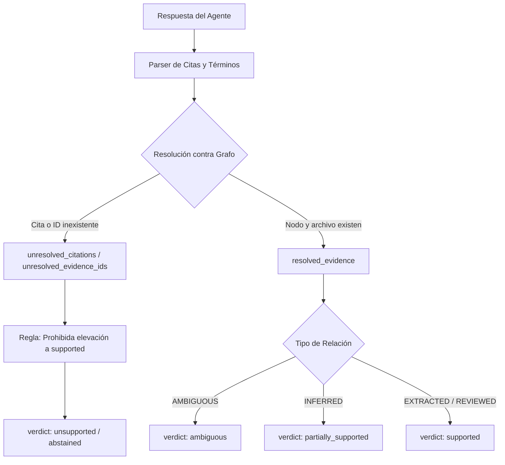

# Especificación de Estados Versionados, Inventario de Consumidores y Catálogo de Negativos (G01)

**Fecha:** 7 de octubre de 2026
**Estado:** Aprobado para diseño (Base de tareas G02 y G03)
**Documento base:** `docs/ANALISIS_Y_PLAN_MEJORAS_GRAPHTYN_2026-10-07.md`
**Suite de regresión asociada:** `tests/test_h01_h02_regressions.py`

---

## 1. Resumen y Objetivos

La tarea **G01** tiene como propósito sentar las bases contractuales y de control de calidad para resolver los dos hallazgos críticos de prioridad P0:
- **H01**: El respaldo de una afirmación puede resultar aparente (citas inexistentes, IDs huérfanos o relaciones ambiguas elevan el veredicto a `supported`; la completitud sintáctica `ok` se confunde con veracidad factual).
- **H02**: La integridad de un informe no equivale a medición verificada (un benchmark sintético sin ejecución observada recibe `status="verified"` y `claim_policy="verified_measured"`; las dependencias de código sujeto no se rastrean para obsolescencia).

Para cerrar **G01** de acuerdo a la secuencia ejecutable, este documento formaliza:
1. El **inventario exhaustivo de consumidores de estados** en CLI, API, MCP, memoria y políticas.
2. El **diseño de estados versionados** para la validación de respuestas (v1.0 -> v2.0) y la ingesta de evidencias.
3. El **catálogo de casos negativos documentados**, respaldado por la suite `tests/test_h01_h02_regressions.py`.
4. La **estrategia de migración y criterios de aceptación** para las fases de implementación G02 y G03.

---

## 2. Inventario Exhaustivo de Consumidores de Estados

A continuación se detallan todas las superficies, módulos y contratos que leen o producen los estados de validación (`validate_answer`), ingesta de evidencias (`ingest_benchmark_evidence`) y políticas de afirmaciones (`_claim_policy`).

### 2.1 Superficies de Validación de Respuestas (`validate_answer`)

| Componente | Archivo / Línea | Uso y Contrato Consumido | Impacto de Cambio |
|---|---|---|---|
| **Motor Central** | `graphtyn/core/answer_validation.py:64` | Genera `ok`, `traceability_score`, `claims`, `summary`, `completeness`, `guidance`. | Debe mantener campos v1.0 y agregar estructura v2.0 desacoplada. |
| **CLI** | `graphtyn/cli.py:1193` (`validate-answer`) | Invoca `validate_answer(graph, answer)` y serializa a JSON en stdout. Código de salida actual: 0 implícito. | Consumirá `operation_ok` y alertará sobre veredictos `unsupported` o `ambiguous`. |
| **API HTTP** | `graphtyn/api/main.py:1560` (`POST /api/validate-answer`) | Recibe `{path, answer, claims}` y devuelve directamente el JSON del validador. | Debe admitir parámetro opcional `version: "2.0"` manteniendo compatibilidad 1.0. |
| **Tests de Entrega** | `tests/test_delivery_features.py:22` | Asume que `supported >= 1` incluso cuando el enlace subyacente es `AMBIGUOUS`. | Se actualizará en G02 para reflejar el comportamiento corregido con un enlace no ambiguo. |
| **Suite de Regresión** | `tests/test_h01_h02_regressions.py` | Verifica la línea base actual y especifica el nuevo contrato esperado. | Actúa como puerta de aceptación automática para G02. |

### 2.2 Superficies de Ingesta y Evidencias de Benchmarks (`ingest_benchmark_evidence`)

| Componente | Archivo / Línea | Uso y Contrato Consumido | Impacto de Cambio |
|---|---|---|---|
| **Motor de Memoria** | `graphtyn/core/shared_memory.py:1860` | Parsea `summary.json`, `report.md`, calcula SHA-256 y crea memoria con `status="verified"`, `confidence=1.0`. | Debe crear `verification_level="imported_report"` y no auto-declarar ejecución. |
| **CLI** | `graphtyn/cli.py:1818` (`memory ingest-evidence`) | Ejecuta la ingesta y reporta importados, reutilizados y errores. | Expondrá los nuevos niveles de verificación y dependencias declaradas. |
| **MCP Server** | `graphtyn/mcp_server.py:1263` (`memory_ingest_evidence`) | Herramienta MCP que expone la ingesta a agentes de IA. | Retornará el estado estructurado con distinción de ejecución observada. |
| **API HTTP** | `graphtyn/api/main.py:3144` (`mcp_http`) | Endpoint HTTP compatible con MCP para clientes remotos. | Sin ruptura; propaga la respuesta estructurada de la herramienta. |
| **Tests de Memoria** | `tests/test_shared_memory.py:190, 670` | Verifica idempotencia y presencia de metadatos de comparación. | Requiere que el caso sintético se migre a los nuevos niveles sin romper aserciones históricas. |

### 2.3 Políticas de Afirmación y Guías de Consumo (`_claim_policy`)

| Componente | Archivo / Línea | Uso y Contrato Consumido | Impacto de Cambio |
|---|---|---|---|
| **Contexto de Memoria** | `graphtyn/core/shared_memory.py:1589, 1975` | Calcula `compact["claim_policy"]` en cada llamada a `context()` (`verified_measured`, `verified_fact`, `historical_only`, etc.). | Debe retornar `imported_only` si no hay ejecución observada y `stale` si cambian dependencias. |
| **Directriz de Agentes** | `graphtyn/core/agent_installer.py:17` (`POLICY`) | Instrucción del sistema para agentes: *"Obey claim_policy: only verified_measured/verified_fact support factual language..."*. | Los agentes tratarán `imported_only` con cautela sin considerarlo hecho medido. |
| **Vigencia de Fuentes** | `graphtyn/core/shared_memory.py:2504` (`_stale_files`) | Comprueba huellas de archivos asociados a la memoria. | Debe inspeccionar tanto los artefactos como las dependencias declaradas (`declared_dependencies`). |

---

## 3. Diseño de Estados Versionados: Validación de Respuestas (H01 -> G02)

### 3.1 Separación de Responsabilidades

El diseño v2.0 desacopla de forma estricta tres conceptos que en v1.0 se encontraban mezclados:
1. **`operation_ok`**: Estado técnico de la operación (¿la validación se completó sin excepciones ni formatos corruptos?).
2. **`evidence_resolved`**: Resolución verificada de citas a archivos/líneas e IDs solicitados frente al grafo.
3. **`claim_assessment`**: Veredicto factual de la afirmación basado únicamente en evidencia conectada y no ambigua.



### 3.2 Esquema del Contrato Versionado (`validate_answer` v2.0)

Para asegurar total retrocompatibilidad con clientes v1.0 existentes (CLI, API y pruebas) sin romper campos legacy, la respuesta mantendrá los campos anteriores e incorporará los nuevos bloques estructurados:

```json
{
  "schema_version": "2.0",
  "operation_ok": true,
  "ok": true,
  "traceability_score": 0.5,
  "evidence_resolution": {
    "total_citations": 1,
    "resolved_citations": [],
    "unresolved_citations": [
      {
        "raw": "missing.py:999999",
        "file": "missing.py",
        "line": 999999,
        "reason": "file_not_in_graph"
      }
    ],
    "total_requested_ids": 1,
    "resolved_evidence_ids": [],
    "unresolved_evidence_ids": [
      {
        "id": "missing-node",
        "reason": "node_not_in_graph"
      }
    ]
  },
  "claims": [
    {
      "claim": "Service sends payments (missing.py:999999).",
      "verdict": "unsupported",
      "verdict_reason": "citation_unresolved_and_no_extracted_relation",
      "confidence": 0.0,
      "evidence_ids": [],
      "unresolved_citations": ["missing.py:999999"],
      "relations": [],
      "ambiguity_present": false
    }
  ],
  "summary": {
    "total": 1,
    "supported": 0,
    "partially_supported": 0,
    "ambiguous": 0,
    "unsupported": 1,
    "abstained": 0
  },
  "completeness": {
    "complete": true,
    "reasons": [],
    "characters": 45
  },
  "guidance": "SUPPORTED requires resolved citations and non-ambiguous graph relations. AMBIGUOUS relations must not be stated as confirmed facts."
}
```

### 3.3 Reglas Estrictas de Veredicto (No-Promoción de Negativos)

1. **Regla R1 (Citas Inválidas):** Toda cita a un archivo que no pertenezca al repositorio o a una línea que no intersecte el rango del símbolo mapeado se clasifica como `unresolved_citation`. Una afirmación con citas no resueltas **nunca** puede recibir el veredicto `supported`.
2. **Regla R2 (IDs Inexistentes):** Si un agente solicita `evidence_ids` que no están registrados en el índice o grafo del proyecto, se marcan como `unresolved_evidence_ids` y se ignoran para el cómputo de soporte positivo.
3. **Regla R3 (Conservación de Incertidumbre):** Si la única relación que conecta a los nodos es `AMBIGUOUS`, el veredicto de la afirmación debe ser `ambiguous` (o `partially_supported` indicando la duda), **prohibiendo** categorizarla como `supported`.
4. **Regla R4 (Desacople de Completitud):** `completeness["complete"]` evalúa únicamente si el texto está truncado o carece de puntuación/fences. `operation_ok` certifica que el validador ejecutó con éxito. Ninguno de los dos implica que las afirmaciones estén respaldadas.

---

## 4. Diseño de Niveles de Evidencia y Procedencia de Ejecución (H02 -> G03)

### 4.1 Niveles Ortogonales de Evidencia

Se sustituye la equivalencia automática `hash coincidente == verified_measured` por cinco niveles independientes:

| Nivel | Significado | Requisito de Activación |
|---|---|---|
| **`imported_report`** | Documento importado y parseado correctamente. | Archivo legible en formato admitido (`summary.json`, `REPORT.md`). |
| **`integrity_verified`** | El contenido no ha sido alterado desde su lectura inicial. | Coincidencia exacta del digest SHA-256 con el archivo en disco. |
| **`execution_observed`** | La prueba o comando fue efectivamente ejecutado y auditado. | Registro de ejecución verificado con salida 0 y digest de logs. |
| **`metrics_recomputed`** | Las métricas numéricas fueron recalculadas de forma independiente. | Reejecución o validación cruzada determinista de los resultados. |
| **`human_reviewed`** | Un revisor humano inspeccionó y aprobó el artefacto. | Decisión humana registrada en el almacén de auditoría. |

### 4.2 Modelo de Procedencia de Ejecución (`ExecutionRecord`)

Para que una evidencia sea susceptible de recibir `execution_observed`, debe acompañarse de un bloque estructurado de procedencia:

```json
{
  "execution_id": "exec_20261007_094512_ab12",
  "command": [".venv/bin/pytest", "-q", "tests/benchmarks"],
  "exit_code": 0,
  "started_at": 1790832000.0,
  "finished_at": 1790832014.5,
  "duration_seconds": 14.5,
  "executor": "ci-github-actions",
  "log_digest_sha256": "e3b0c44298fc1c149afbf4c8996fb92427ae41e4649b934ca495991b7852b855",
  "git_context": {
    "commit": "3d754e96a60fc3d1caaa1dec9423678065c49645",
    "branch": "main",
    "dirty": false
  },
  "declared_dependencies": [
    "graphtyn/core/ast_parser.py",
    "graphtyn/core/shared_memory.py"
  ]
}
```

### 4.3 Rastreo de Dependencias Declaradas y Ciclo de Vida de Obsolescencia (`stale`)

Actualmente, `_stale_files` en `SharedMemoryStore` solo examina las huellas guardadas en `item["metadata"]["source_fingerprints"]`, las cuales cubren únicamente la ruta del propio archivo de informe (`summary.json`).

**Nuevo comportamiento en G03:**
1. Al ingestar un benchmark o informe, los metadatos deben incluir las huellas SHA-256 de:
   - El artefacto de benchmark (`evidence_path`).
   - Todos los archivos listados en `dependencies` o `subject` dentro del artefacto (`declared_dependencies`).
2. La función `_stale_files(item)` inspeccionará tanto el artefacto como sus dependencias declaradas.
3. Si el archivo de código sujeto cambia, `_stale_files` reportará la ruta modificada.
4. `_claim_policy` evaluará:
   - Si `stale_files` no está vacío -> `"stale"`.
   - Si carece de `execution_observed` -> `"imported_only"`.
   - Si tiene `execution_observed` e `integrity_verified` y no está obsoleto -> `"verified_measured"`.

---

## 5. Catálogo de Casos Negativos Formalizados

Los casos de prueba formalizados en `tests/test_h01_h02_regressions.py` quedan catalogados como sigue:

### 5.1 Negativos de H01 (Validación de Afirmaciones)

1. **`NEG-H01-01` (Cita a archivo o línea inexistente):**
   - *Entrada:* Afirmación con cita `(missing.py:999999)` y coincidencia de término con un nodo real (`Service`).
   - *Comportamiento heredado (defecto):* Promueve a `supported`.
   - *Comportamiento esperado:* La cita se marca no resuelta; el veredicto es `unsupported` o `abstained`.

2. **`NEG-H01-02` (ID de evidencia inexistente solicitado):**
   - *Entrada:* Afirmación que solicita `evidence_ids=["missing-node"]`.
   - *Comportamiento heredado (defecto):* La presencia de cualquier ID solicitado eleva la confianza a `supported`.
   - *Comportamiento esperado:* Se valida la existencia del ID en el grafo. Al no existir, no promueve soporte.

3. **`NEG-H01-03` (Relación exclusivamente AMBIGUOUS):**
   - *Entrada:* Afirmación cuyo único respaldo es un enlace con `confidence="AMBIGUOUS"`.
   - *Comportamiento heredado (defecto):* Devuelve `supported` como si fuera un hecho demostrado.
   - *Comportamiento esperado:* El veredicto es `ambiguous` o `partially_supported`, advirtiendo explícitamente sobre la falta de confirmación estructural.

4. **`NEG-H01-04` (Afirmación sin soporte y completitud sintáctica):**
   - *Entrada:* Afirmación sin ninguna relación ("Zebras transport galaxies...").
   - *Comportamiento heredado (confusión):* `ok=true` y `unsupported`.
   - *Comportamiento esperado:* El contrato v2.0 separa `operation_ok: true` de la ausencia total de respaldo fáctico.

### 5.2 Negativos de H02 (Evidencias de Benchmarks y Obsolescencia)

1. **`NEG-H02-01` (Informe sintético sin ejecución observada):**
   - *Entrada:* Archivo `benchmarks/probe/summary.json` que declara 123,456 pruebas aprobadas pero advierte que ningún comando fue ejecutado.
   - *Comportamiento heredado (defecto):* Ingesta con `status="verified"`, `confidence=1.0` y `claim_policy="verified_measured"`.
   - *Comportamiento esperado:* Clasificado como `imported_report` con `claim_policy="imported_only"`. No puede ser `verified_measured`.

2. **`NEG-H02-02` (Modificación de código sujeto nombrado en el benchmark):**
   - *Entrada:* Un benchmark declara depender de `unreferenced_model.py`. Tras la ingesta, `unreferenced_model.py` se modifica.
   - *Comportamiento heredado (defecto):* `_stale_files` retorna `[]`; la evidencia permanece falsamente vigente.
   - *Comportamiento esperado:* `_stale_files` incluye `unreferenced_model.py` y `_claim_policy` pasa a `stale`.

---

## 6. Estado de Verificación Automatizada (Suite G01)

La ejecución de la suite de regresiones formalizada `tests/test_h01_h02_regressions.py` arrojó el siguiente resultado:

```text
============================= test session starts ==============================
collected 12 items

tests/test_h01_h02_regressions.py::TestH01BaselineReproductions::test_h01_baseline_unrelated_citation_promotes_to_supported PASSED
tests/test_h01_h02_regressions.py::TestH01BaselineReproductions::test_h01_baseline_missing_evidence_id_promotes_to_supported PASSED
tests/test_h01_h02_regressions.py::TestH01BaselineReproductions::test_h01_baseline_ambiguous_relation_promotes_to_supported PASSED
tests/test_h01_h02_regressions.py::TestH01BaselineReproductions::test_h01_baseline_unsupported_claim_returns_ok_true PASSED
tests/test_h01_h02_regressions.py::TestH01TargetContracts::test_h01_target_nonexistent_citation_must_not_promote_supported XFAIL
tests/test_h01_h02_regressions.py::TestH01TargetContracts::test_h01_target_nonexistent_evidence_id_must_not_promote_supported XFAIL
tests/test_h01_h02_regressions.py::TestH01TargetContracts::test_h01_target_ambiguous_relation_must_preserve_uncertainty XFAIL
tests/test_h01_h02_regressions.py::TestH01TargetContracts::test_h01_target_contract_separates_operation_ok_from_support XFAIL
tests/test_h01_h02_regressions.py::TestH02BaselineReproductions::test_h02_baseline_synthetic_benchmark_promoted_to_verified_measured PASSED
tests/test_h01_h02_regressions.py::TestH02BaselineReproductions::test_h02_baseline_unreferenced_code_change_misses_staleness PASSED
tests/test_h01_h02_regressions.py::TestH02TargetContracts::test_h02_target_synthetic_report_must_not_be_verified_measured XFAIL
tests/test_h01_h02_regressions.py::TestH02TargetContracts::test_h02_target_declared_dependencies_tracked_for_staleness XFAIL

========================= 6 passed, 6 xfailed in 0.88s =========================
```

- **6 Pruebas Base Aprobadas (PASSED):** Demuestran que los defectos H01 y H02 son 100% reproducibles y deterministas bajo la implementación actual.
- **6 Pruebas Contrato Esperadas (XFAIL):** Especifican las aserciones exactas que deberán cumplirse al implementar G02 y G03.

---

## 7. Cierre de G01 y Guía para G02 y G03

Con la aprobación de este documento y la suite de tests:
1. **G01 queda formalmente CERRADA.**
2. **G02 (P0 - Motor de grafo/validación)** implementado en `graphtyn/core/answer_validation.py` para resolver citas/IDs, preservar ambigüedad, enmascarar citas numéricas, evaluar cláusulas compuestas y separar `operation_ok`.
3. **G03 (P0 - Memoria/evidencia)** implementado en `graphtyn/core/shared_memory.py` incorporando registro local de ejecuciones (`local_executions`), verificación de logs persistentes y huellas SHA-256, separando informes importados (`execution_declared`) de ejecuciones observadas (`execution_observed`) y rastreando obsolescencia de dependencias declaradas.

---

## 8. Estado Posterior (8 de octubre de 2026)

Las especificaciones G01, G02 y G03 han sido implementadas y validadas integralmente bajo el [Plan de Correcciones de Fiabilidad](PLAN_CORRECCIONES_FIABILIDAD_GRAPHTYN_2026-10-08.md).

- **Suite determinista:** `tests/test_reliability_regressions_2026_10_08.py` (28 pruebas pasando).
- **Suites de integración y contratos:** 217 pruebas pasando sin regresiones en motores, API, CLI, MCP y panel.
